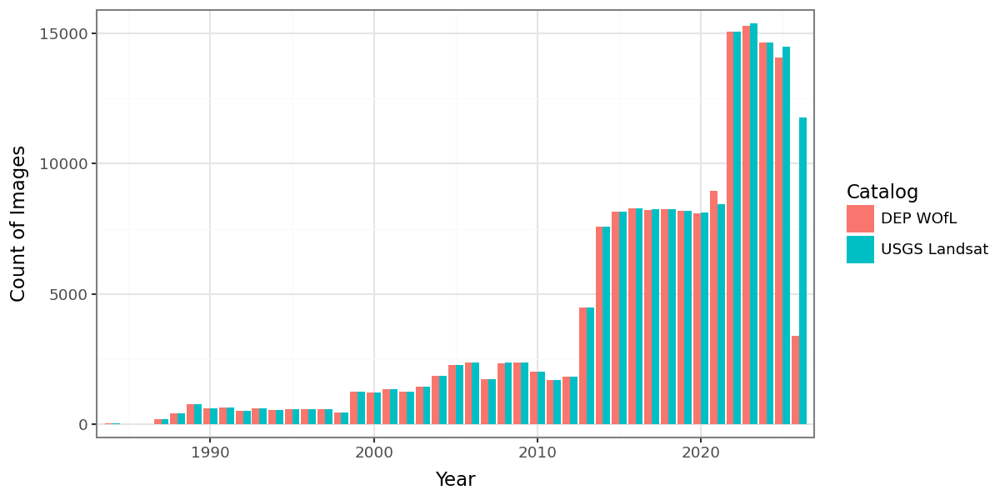
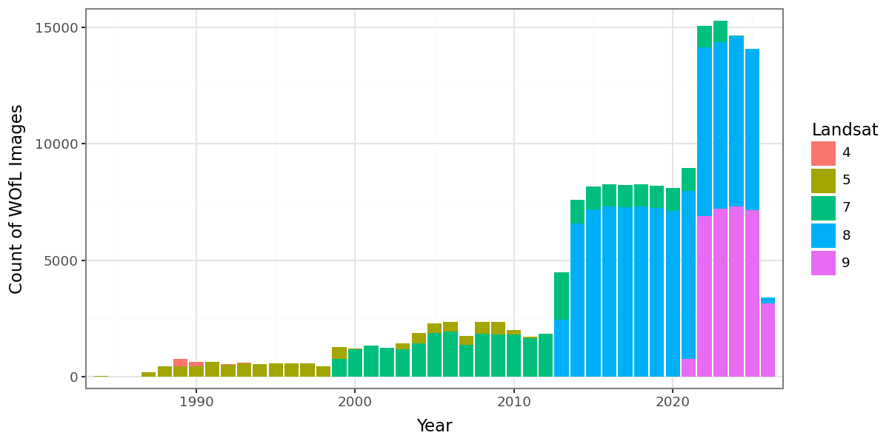

# Validation

This folder contains an accuracy assessment of the Digital Earth Pacific 
WOfL (scene-level water) product, comparing WOfL wet/dry classes to 
manually labelled points.

## Sampling design

[create_random_samples.py](create_random_samples.py) builds the sample:

1. For each of 15 WRS-2 path/rows spread across the region, it randomly selects 3
   `dep_ls_wofl` items with cloud cover under 40%.
2. Each WOfL is split into four strata: wet or dry, crossed with land or ocean
   according to GADM. Small areas are removed with a 3-pixel erosion and
   dilation (to improve interpretability for hand labelled areas).
3. Up to 25 random points are placed in each stratum, all at least 250 m apart.
4. For each scene it writes:
   - `<scene_id>.gpkg`: points with their stratum (`name`).
   - `<scene_id>_blinded.gpkg`: the same points shuffled, without the stratum
     and with an empty `label` column.
   - `<scene_id>_rgb.tif`: a stretched 8-bit true-colour image of the source
     Landsat scene, used as the labelling backdrop.
   - `<scene_id>_classes.tif`: the stratum rasters.

Outputs go to `data/validation/` at the repo root, which is not in git.

## Labelling

Points in each `_blinded.gpkg` file were labelled by hand against the RGB image,
without seeing the WOfL class. Labels are `w` (wet), `l` (land, i.e. dry),
`c` (cloud) and `u` (unknown). Labelled files were moved to
`data/validation/labeled/`. Scenes that could not be labelled were moved to
`data/validation/bad_data/`.

### Correction to the GADM strata

Some points that were labelled dry fell in the `dry_ocean` stratum. Hand
checking showed that these are on land the Pacific GADM data does not include,
WOfL classified them correctly, so [accuracy_report.py](accuracy_report.py) 
moves them to the `dry_land` stratum.

## Files

| File | Description |
|---|---|
| [create_random_samples.py](create_random_samples.py) | Selects scenes and places sample points (see above). Needs AWS credentials (requester-pays Landsat data). |
| [accuracy_report.py](accuracy_report.py) | Joins each labelled `_blinded.gpkg` in `data/validation/labeled/` to its strata, calculates confusion matrices and overall, user's and producer's accuracy, and writes the [accuracy report](accuracy_report/accuracy_report.md) from [its template](accuracy_report_template.md). |
| [validation_data.gpkg](validation_data.gpkg) | Labelled points used in the accuracy report, written by `accuracy_report.py` (see below). This is the only copy of the reference data in git. |
| [landsat_item_tally.py](landsat_item_tally.py) | Counts `dep_ls_wofl` items per year and Landsat platform, compares them to the upstream USGS Landsat Collection 2 Level 2 scenes for the same path/rows, and writes the [Landsat item tally report](landsat_item_tally/landsat_item_tally.md) from [its template](landsat_item_tally_template.md). Not part of the accuracy assessment, but describes the archive that was sampled and shows any scenes not yet processed. |

### validation_data.gpkg

Layer `validation_data`, EPSG:3832, one row per labelled point (points
labelled unknown are excluded).

| Column | Description |
|---|---|
| `name` | Stratum: `dry_land`, `dry_ocean`, `wet_land` or `wet_ocean` |
| `reference` | Manual label: `wet`, `dry` or `cloud` |
| `wofl` | WOfL class: `wet` or `dry` |
| `combined` | `<wofl>_<reference>` |
| `id` | Landsat scene ID |
| `modified_time` | Modification time of the labelled file, used to order scenes |

### Landsat item tally

WOfL items compared to upstream USGS scenes, and WOfL items by Landsat
platform. See the [report](landsat_item_tally/landsat_item_tally.md) for the
tables.





## Running

Install the extra dependencies (plotnine, tabulate) and run scripts from this
folder, as they import each other as siblings:

```
uv sync --group validation
cd validation
python create_random_samples.py
python accuracy_report.py
python landsat_item_tally.py
```

`accuracy_report.py` needs the labelled data in `data/validation/labeled/`.

## Results

See the [accuracy report](accuracy_report/accuracy_report.md).
