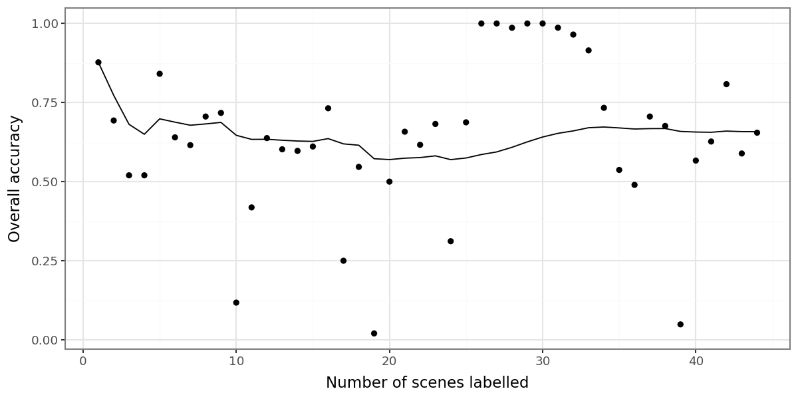

# WOfL accuracy report

Accuracy of Digital Earth Pacific WOfL wet/dry classes against hand-labelled
points. See the [validation README](../README.md) for how the points were
sampled and labelled. Generated 2026-10-27 by `accuracy_report.py`.

## Points labelled

3435 points in 44 scenes, by stratum (rows) and hand label
(columns). The 297 points labelled unknown are left out of
everything below.

| name      |   cloud |   dry |   unknown |   wet |   All |
|:----------|--------:|------:|----------:|------:|------:|
| dry_land  |      82 |   981 |        57 |     3 |  1123 |
| dry_ocean |     389 |     0 |        27 |   454 |   870 |
| wet_land  |      25 |    26 |        67 |   341 |   459 |
| wet_ocean |      91 |     3 |       146 |   743 |   983 |
| All       |     587 |  1010 |       297 |  1541 |  3435 |

## Overall accuracy

| | Accuracy (%) |
|:--|--:|
| All points | 65.8 |
| Inland points (GADM land) | 90.7 |

18.7% of points were labelled cloud. These count as errors, since
WOfL classified them as wet or dry.

## Confusion matrices

WOfL class (rows) against hand label (columns), for all points:

| wofl   |   cloud |   dry |   wet |
|:-------|--------:|------:|------:|
| dry    |     471 |   981 |   457 |
| wet    |     116 |    29 |  1084 |

And for inland points only:

| wofl   |   cloud |   dry |   wet |
|:-------|--------:|------:|------:|
| dry    |      82 |   981 |     3 |
| wet    |      25 |    26 |   341 |

## User's and producer's accuracy (%)

|     |   User's |   Producer's |   Inland user's |   Inland producer's |
|:----|---------:|-------------:|----------------:|--------------------:|
| dry |     51.4 |         97.1 |              92 |                97.4 |
| wet |     88.2 |         70.3 |              87 |                99.1 |

## Accuracy by stratum

Percent of each stratum's points given each hand label, and the stratum's
user's accuracy.

| name      |   cloud |   dry |   wet |   user's accuracy |
|:----------|--------:|------:|------:|------------------:|
| dry_land  |     7.7 |  92   |   0.3 |              92   |
| dry_ocean |    46.1 |   0   |  53.9 |               0   |
| wet_land  |     6.4 |   6.6 |  87   |              87   |
| wet_ocean |    10.9 |   0.4 |  88.8 |              88.8 |

## Accuracy against number of scenes labelled

Points show each scene's accuracy and the line shows cumulative accuracy, with
scenes in the order they were labelled. A flat line suggests enough scenes
were labelled.

